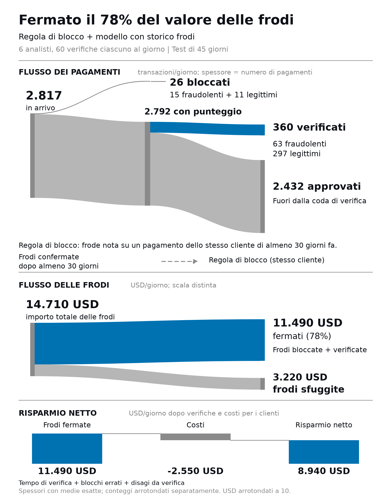
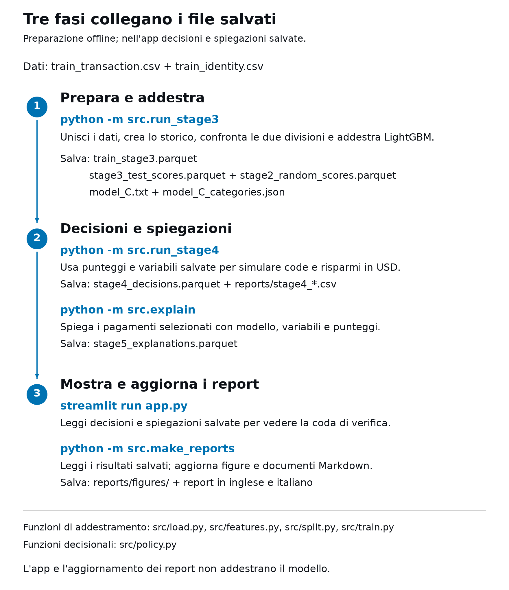

# Coda dei controlli antifrode

[English](README.md) | [Italiano](README.it.md)

Una banca non può controllare ogni pagamento con carta: gli analisti ne esaminano una piccola quota ogni giorno. Ho costruito una coda che sceglie quali pagamenti mostrare e misurato il risparmio simulato di ciascun analista.
App online: [Coda dei controlli antifrode](https://gr1gorii-fraud-alert-queue.streamlit.app/)


## Risultati (45 giorni di test, USD)

- Con **6 analisti** e **Regola di blocco + modello con storico frodi**, i controlli coprono il **13%** dei pagamenti e fermano il **78%** degli importi fraudolenti, con un risparmio netto di **USD 8.940/giorno**.
- **Regola di blocco + modello** aggiunge **USD 6.360/giorno di risparmio netto** rispetto a **Solo regola di blocco**, con lo stesso organico di 6 analisti.
- Il primo analista aggiunge **USD 3.570/giorno**; il 6° e ultimo utile aggiunge soltanto **USD 130/giorno**.
- La divisione casuale sovrastima il PR-AUC del **65%**: **0,77** contro **0,47** della divisione temporale.


## Il percorso di un pagamento

Medie giornaliere sui 45 giorni di test per **Regola di blocco + modello con storico frodi** con 6 analisti; i valori sono arrotondati separatamente.

<picture>
  <source media="(prefers-color-scheme: dark)" srcset="reports/figures/it/payment_flow_dark.png">
  <source media="(prefers-color-scheme: light)" srcset="reports/figures/it/payment_flow_light.png">
  
</picture>

La freccia tratteggiata mostra le frodi confermate che aggiornano la regola di blocco dopo 30 giorni, quando arrivano le etichette; il modello resta invariato durante il test.

## Come funziona

1. Ho scelto una divisione temporale: gli ultimi 45 giorni servono per il test, separati dall'addestramento da 30 giorni di attesa per i chargeback tardivi. I 15 giorni prima di questo intervallo servono per la validazione e l'arresto anticipato.
2. L'identificativo del cliente combina carta, indirizzo e inizio dell'account. Lo storico comprende soltanto pagamenti precedenti e tratta insieme quelli con lo stesso timestamp.
3. Le frodi su pagamenti di almeno 30 giorni prima diventano utilizzabili per il blocco automatico quando arriva l'etichetta. Aggiungendo le frodi note allo storico, il PR-AUC dei clienti già osservati passa da **0,20 a 0,51**; per i nuovi clienti resta **0,64**.
4. I costi ipotizzati comprendono lavoro degli analisti, blocchi errati e attrito per i controlli legittimi; il lavoro è già incluso nel costo del controllo. Le ipotesi precise e gli scenari alternativi sono nella [tabella di sensibilità](reports/stage4_policy.it.md#sensibilità).


## Demo


La vista iniziale usa l'organico di riferimento di 6 analisti e i risultati di test salvati.


Ogni controllo mostra dati leggibili sul pagamento e sul cliente ricavati dai contributi raggruppati: descrivono il punteggio e non dimostrano che ci sia una frode.

## Limiti

L'organico viene scelto sugli stessi giorni di test usati per misurare il risparmio. Si assume di individuare tutte le frodi controllate e impedirne l'intero importo in USD. I costi sono ipotesi: la [tabella di sensibilità](reports/stage4_policy.it.md#sensibilità) confronta scenari diversi. La maggior parte delle variabili è anonimizzata dal fornitore dei dati.

## Esecuzione

Serve Python 3.12 o successivo. I due CSV di addestramento della competizione vanno in `data/raw/`; punteggi e spiegazioni si preparano offline, senza addestrare modelli nell'app.

`src.run_stage3` coordina il caricamento, lo storico dei clienti, la divisione e l'addestramento, salvandone i risultati; gli script successivi usano questi file.

<picture>
  <source media="(prefers-color-scheme: dark)" srcset="reports/figures/it/pipeline_dark.png">
  <source media="(prefers-color-scheme: light)" srcset="reports/figures/it/pipeline_light.png">
  
</picture>

`src.make_reports` aggiorna i rapporti e i grafici in inglese e italiano a partire dai risultati salvati.

```sh
cd ~/Projects/fraud-alert-queue
python3.12 -m venv .venv
source .venv/bin/activate
python -m pip install -r requirements.txt
python -m src.run_baseline
python -m src.run_stage3
python -m src.run_stage4
python -m src.explain
python -m src.make_reports
python -m unittest discover -s tests -v
streamlit run app.py
```

Le schermate vengono acquisite in entrambe le lingue, a 1440x900, da un processo locale separato:

```sh
python -m playwright install chromium
python -m src.screenshots
```

Le spiegazioni coprono l'unione delle code del modello con una quota del 20% di tutti i pagamenti giornalieri, escludendo i blocchi automatici dall'ordinamento. L'intera coda resta visibile anche quando manca una spiegazione salvata. Su macOS può servire `libomp` di Homebrew per LightGBM.

## Dati

I dati provengono dalla [competizione Kaggle IEEE-CIS Fraud Detection](https://www.kaggle.com/competitions/ieee-fraud-detection/data) e le tabelle grezze di addestramento non sono incluse nel repository. I valori esatti restano nel [rapporto del modello di base](reports/baseline_metrics.it.md), nel [rapporto sullo storico del cliente](reports/stage3_metrics.it.md) e nel [rapporto sulle regole](reports/stage4_policy.it.md).

## Licenza

Distribuisco il codice e la documentazione con [licenza MIT](LICENSE). Il dataset esterno di Kaggle resta soggetto alle proprie condizioni di uso.

Le tabelle grezze di addestramento della competizione non sono incluse. L’app pubblica usa le decisioni sul test e le spiegazioni bilingui salvate in `demo/`, senza addestrare modelli.
