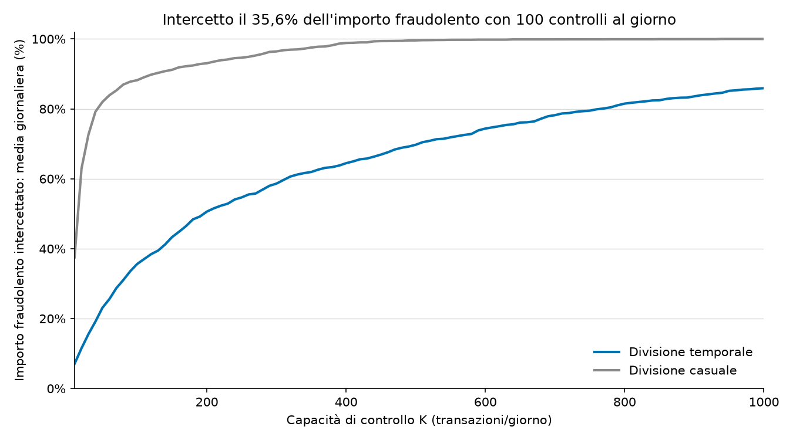
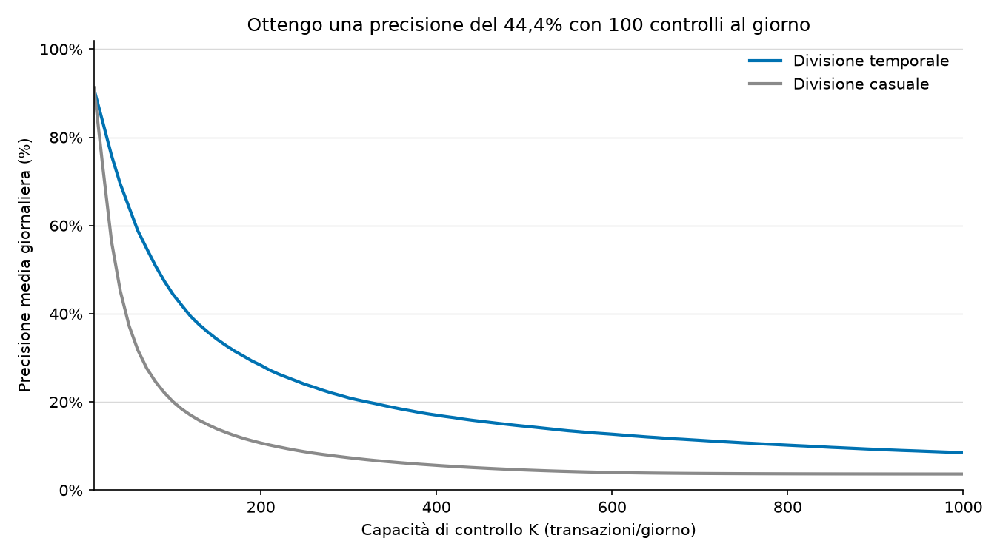
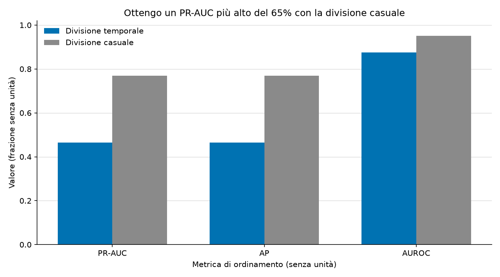

[English](README.md) | [Italiano](README.it.md)

# Coda degli avvisi di frode

Io ordino le transazioni per una coda giornaliera di controlli antifrode con un modello LightGBM a parametri fissi.

**PR-AUC: 0,4654 temporale, 0,7691 casuale.** Con 100 controlli al giorno intercetto il **35,64%** degli importi fraudolenti giornalieri, con una **precisione del 44,38%** sul test temporale.





## Metodo

Riservo 45 giorni al test, escludo i 30 giorni precedenti per il ritardo dei chargeback e uso i 15 giorni ancora precedenti per la validazione. Addestro il modello sulle righe più vecchie.
Uso le variabili originali, imparo le categorie solo dall'addestramento e fisso il seme a 42. Per l'arresto anticipato uso solo la validazione. Non creo nuove variabili e non ottimizzo gli iperparametri.

Confronto una divisione casuale 80/20 stratificata, con la validazione ricavata dall'80% dei dati riservato allo sviluppo.
Nel test casuale valuto circa il 20% delle transazioni di ogni giorno. A parità di K controllo una quota maggiore di questa coda; non attribuisco la differenza soltanto all'uso di informazioni future.

## Esecuzione

Uso Python 3.12+ e inserisco `train_transaction.csv` e `train_identity.csv` in `data/raw/`.

```sh
cd ~/Projects/fraud-alert-queue
python3.12 -m venv .venv
source .venv/bin/activate
python -m pip install -r requirements.txt
python -m src.run_baseline
python -m unittest discover -s tests -v
```

Su macOS installo `libomp` con Homebrew se LightGBM lo richiede.
A ogni esecuzione ricostruisco `data/processed/train.parquet` e salvo i [risultati in inglese](reports/baseline_metrics.md), i [risultati in italiano](reports/baseline_metrics.it.md), i CSV giornalieri e i grafici.

## Dati

Uso i dati della [competizione Kaggle IEEE-CIS Fraud Detection](https://www.kaggle.com/competitions/ieee-fraud-detection/data); non includo i dati nel repository.
