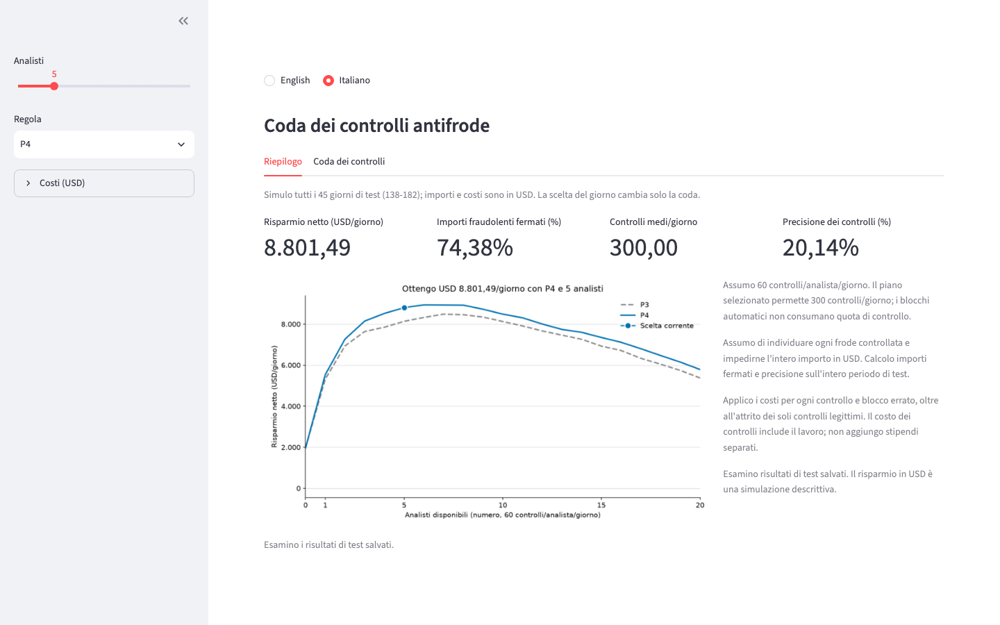
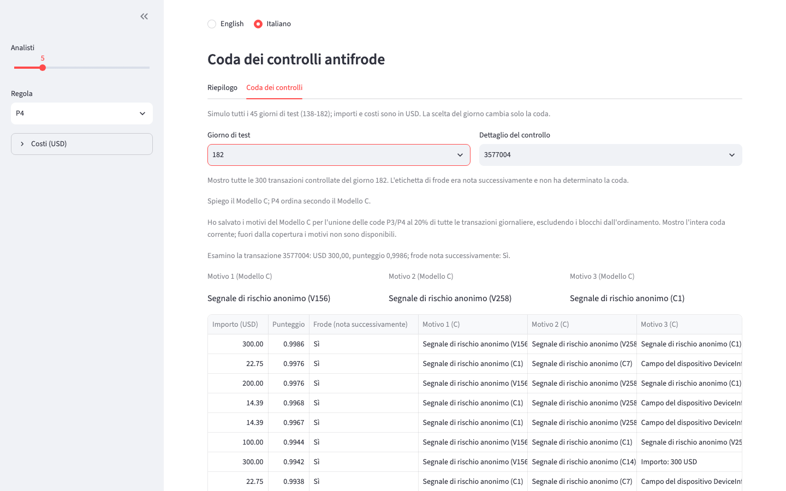
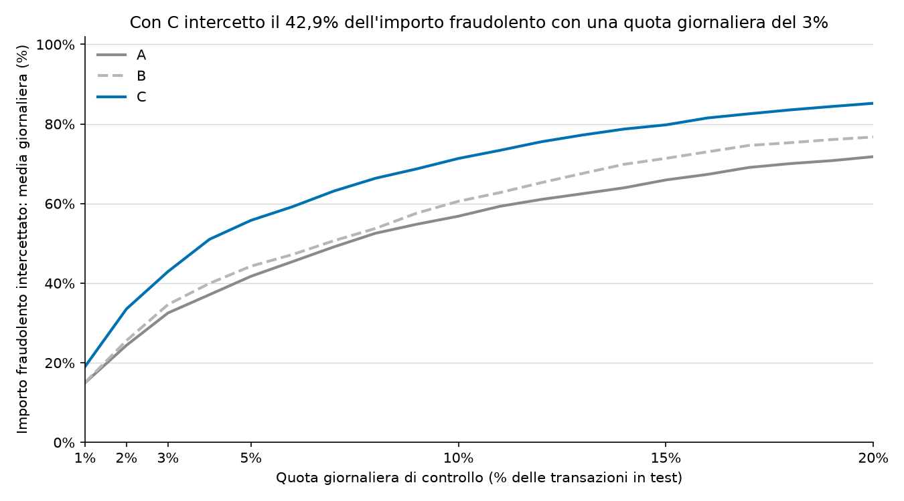
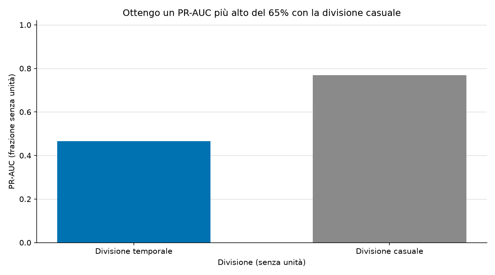

[English](README.md) | [Italiano](README.it.md)

# Coda dei controlli antifrode

Simulo blocchi antifrode e organico dei controlli giornalieri per confrontare il risparmio netto in USD.

**Con P4 e cinque analisti ottengo USD 8.801,49/giorno; il sesto aggiunge solo USD 134,70/giorno.** Assumo 60 controlli/analista/giorno: cinque analisti hanno un budget fisso di 300 controlli al giorno.





Allo stesso budget di cinque analisti ottengo **USD 8.135,26/giorno con P3 rispetto a USD 1.966,44/giorno con P1 e soli blocchi**, con un incremento di **USD 6.168,82/giorno**.
Esamino quote e organico dopo aver osservato gli stessi 45 giorni di test. Considero questi risultati in USD una simulazione descrittiva.





Mantengo il Modello C della fase 3 a **PR-AUC 0,5864**, con il **42,92% degli importi fraudolenti in USD intercettati in media ogni giorno** e **precisione 59,87%** controllando il 3% delle transazioni. Nella fase 2 ottengo **PR-AUC 0,4654 per la divisione temporale e 0,7691 per quella casuale**, con il **32,52% e il 61,37% degli importi fraudolenti in USD intercettati in media ogni giorno** alla stessa quota.

## Metodo

Blocco solo in base alle etichette di frode disponibili dopo 30 giorni e ordino la coda restante con i punteggi fissi di LightGBM. Assumo USD 5,00/controllo, USD 15,00/blocco errato e USD 2,00 di attrito per ogni controllo legittimo. Assumo di individuare tutte le frodi controllate e impedirne il valore completo in USD. I blocchi non consumano quota di controllo; il costo dei controlli include il lavoro, quindi non aggiungo stipendi separati.
Esamino quote dallo 0,5% al 40%, confronto solo i nuovi controlli per il valore marginale e riporto piani separati per P3 e P4 con 1-20 analisti.
Mantengo test di 45 giorni, attesa di 30 giorni, validazione di 15 giorni, seme 42 e arresto anticipato basato solo sulla validazione. Imparo le categorie solo sull'addestramento e non ottimizzo gli iperparametri. Nella fase 4 calcolo quote degli importi fraudolenti in USD e precisioni sull'intero periodo; nella fase 3 uso medie a pesi giornalieri uguali.

## Esecuzione

Uso Python 3.12+ e metto `train_transaction.csv` e `train_identity.csv` in `data/raw/`. Eseguo la fase 4 dopo la fase 3 dai punteggi salvati e non addestro modelli nella fase 4.

```sh
cd ~/Projects/fraud-alert-queue
python3.12 -m venv .venv
source .venv/bin/activate
python -m pip install -r requirements.txt
python -m src.run_baseline
python -m src.run_stage3
python -m src.run_stage4
python -m unittest discover -s tests -v
```

Su macOS installo `libomp` con Homebrew se LightGBM lo richiede. Salvo localmente i risultati della [fase 2](reports/baseline_metrics.it.md), della [fase 3](reports/stage3_metrics.it.md) e della [fase 4](reports/stage4_policy.it.md).

## Avvio della demo

Preparo le spiegazioni del Modello C offline. Quando serve ricostruisco l'addestramento a parametri fissi e verifico tutti i punteggi di test salvati prima di memorizzare i contributi. Nell'app leggo decisioni e spiegazioni salvate; non addestro modelli.

```sh
python -m src.explain
streamlit run app.py
```

Mostro l'intera coda dei controlli. Salvo i motivi soltanto per l'unione delle code P3/P4 con una quota del 20% di tutte le transazioni giornaliere, escludendo i blocchi automatici dall'ordinamento; fuori da questa copertura non sono disponibili. I contributi descrivono il punteggio del Modello C, non l'esito della frode. P3 ordina secondo il Modello B e mostra i motivi del Modello C.

Installo Chromium una volta e acquisisco soltanto l'app locale in entrambe le lingue a 1440x900:

```sh
python -m playwright install chromium
python -m src.screenshots
```

## Dati

Uso i dati della [competizione Kaggle IEEE-CIS Fraud Detection](https://www.kaggle.com/competitions/ieee-fraud-detection/data); non includo i dati nel repository.
