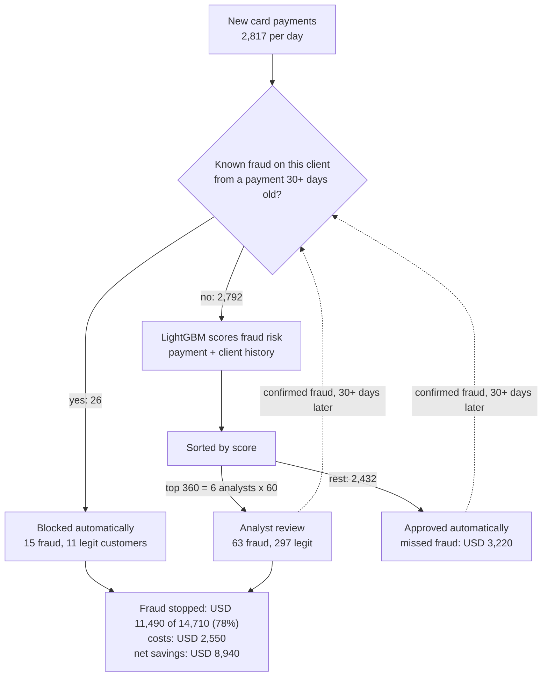
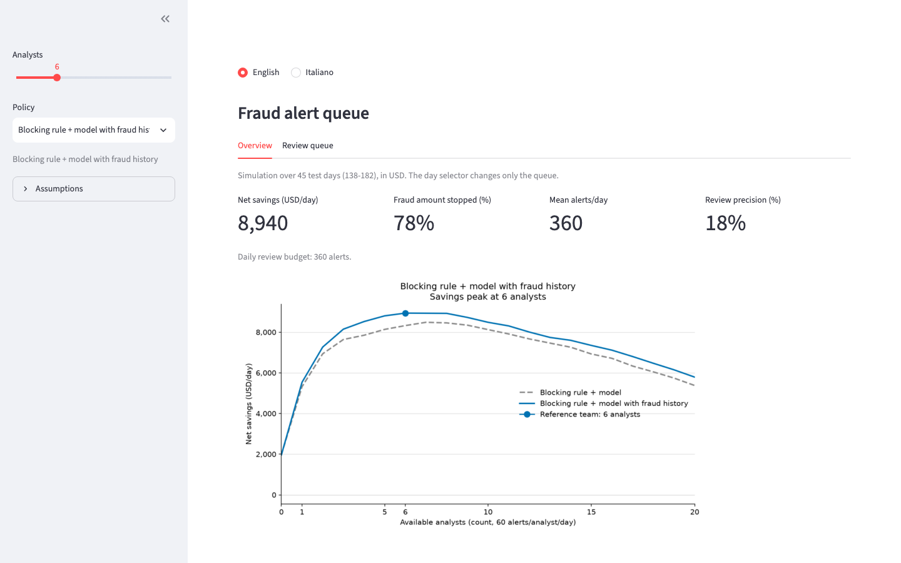
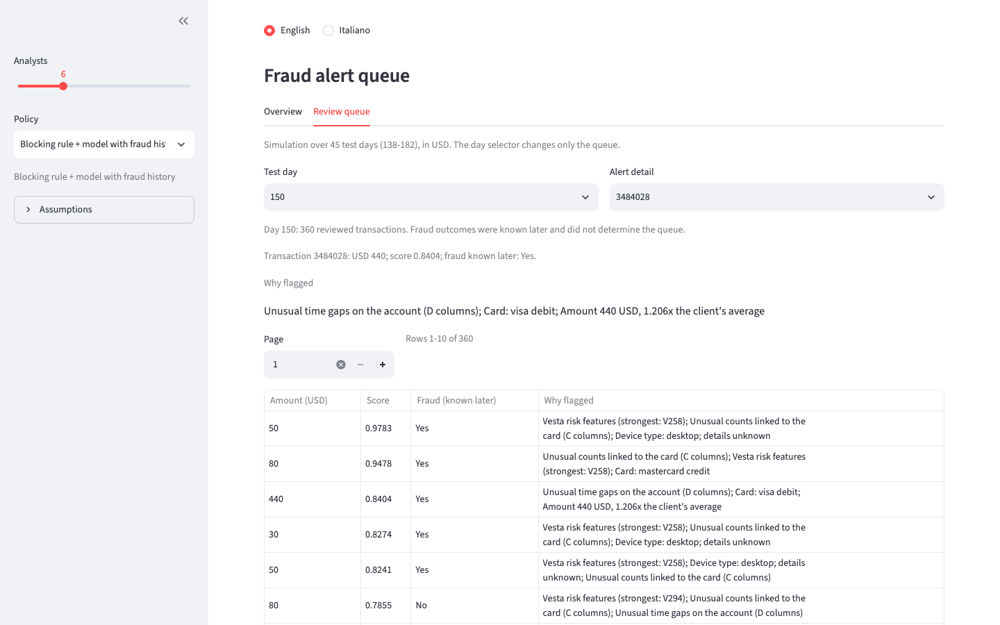
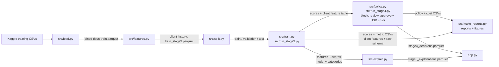

# Fraud alert queue

[English](README.md) | [Italiano](README.it.md)

A bank cannot review every card payment, so analysts check a small share each day. I built a queue that decides which payments they see and measured the simulated savings from each analyst.

## Results (45 test days, USD)

- **6 analysts** with **Blocking rule + model with fraud history** review **13%** of payments, stop **78%** of fraud USD, and save **USD 8,940/day** net.
- **Blocking rule + model** adds **USD 6,360/day in net savings** over **Blocking rule only** at the same 6-analyst budget.
- The first analyst adds **USD 3,570/day**; the 6th, last useful analyst adds only **USD 130/day**.
- Random splitting overstates PR-AUC by **65%**: **0.77** versus **0.47** with time splitting.


## How a payment moves

Daily averages over 45 test days for **Blocking rule + model with fraud history** with 6 analysts; values are rounded independently.



The dashed arrow is the only feedback loop: confirmed fraud feeds the blocking rule, and the model is not retrained during the test period.

## How it works

1. I split by time, reserve the last 45 days for test, and leave a 30-day gap for late chargebacks. The 15 days before the gap provide validation for early stopping.
2. A client ID combines the card, address, and account start. Client histories use only earlier payments, including strict handling of timestamp ties.
3. Frauds on payments at least 30 days old become available for automatic blocking when their labels arrive. Adding known fraud to client history lifts returning-client PR-AUC from **0.20 to 0.51**; new clients stay at **0.64**.
4. Costs assume analyst time, false blocks, and friction for legitimate reviews; labour is already included. Exact unit assumptions and alternatives are in the [cost sensitivity table](reports/stage4_policy.md#sensitivity).


## Demo



The default view uses the 6-analyst reference team and saved test results.



Each alert shows readable payment and client facts from grouped score contributions; these describe the score rather than prove fraud.

## Limitations

Team size is chosen on the same test days used to measure savings. Every reviewed fraud is assumed to be caught, and its full USD value prevented. Costs are assumptions; the [sensitivity table](reports/stage4_policy.md#sensitivity) shows alternative scenarios. Most features are anonymized by the data provider.

## Run

Python 3.12+ is required. The two competition training CSVs belong in `data/raw/`; saved scores and explanations are prepared offline, and the app fits no models.

`src.run_stage3` coordinates loading, client features, splitting and training, and saves their outputs; the later scripts use those saved files.



`src.make_reports` refreshes the English and Italian reports and figures from saved results.

```sh
cd ~/Projects/fraud-alert-queue
python3.12 -m venv .venv
source .venv/bin/activate
python -m pip install -r requirements.txt
python -m src.run_baseline
python -m src.run_stage3
python -m src.run_stage4
python -m src.explain
python -m unittest discover -s tests -v
streamlit run app.py
```

Screenshots use a separate local app process in both languages at 1440x900:

```sh
python -m playwright install chromium
python -m src.screenshots
```

Explanations cover the union of the model review queues at a 20% share of all daily payments, excluding automatic blocks from ranking. The full queue remains visible when a saved explanation is unavailable. On macOS, LightGBM may need Homebrew's `libomp`.

## Data

The data comes from the [Kaggle IEEE-CIS Fraud Detection competition](https://www.kaggle.com/competitions/ieee-fraud-detection/data) and is not included in the repository. Exact results remain in the [baseline report](reports/baseline_metrics.md), [client-history report](reports/stage3_metrics.md), and [policy report](reports/stage4_policy.md).
