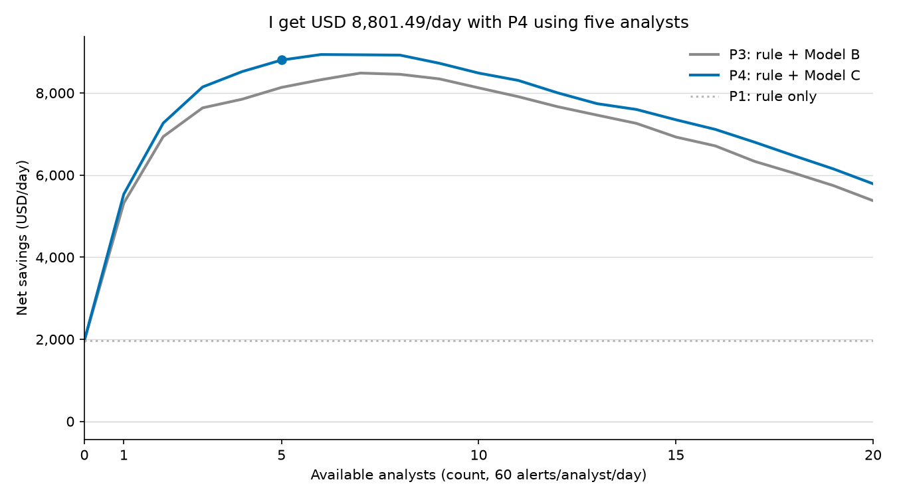
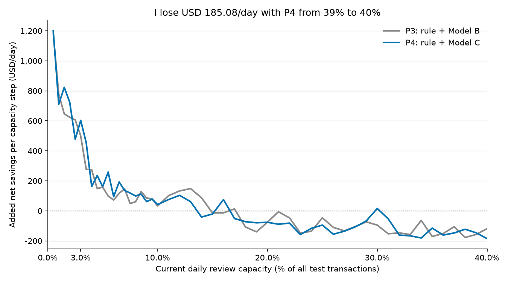
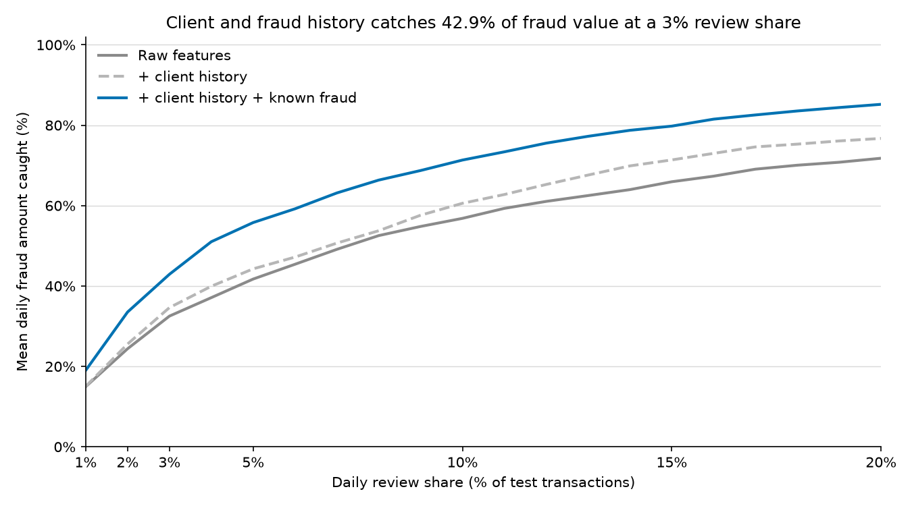
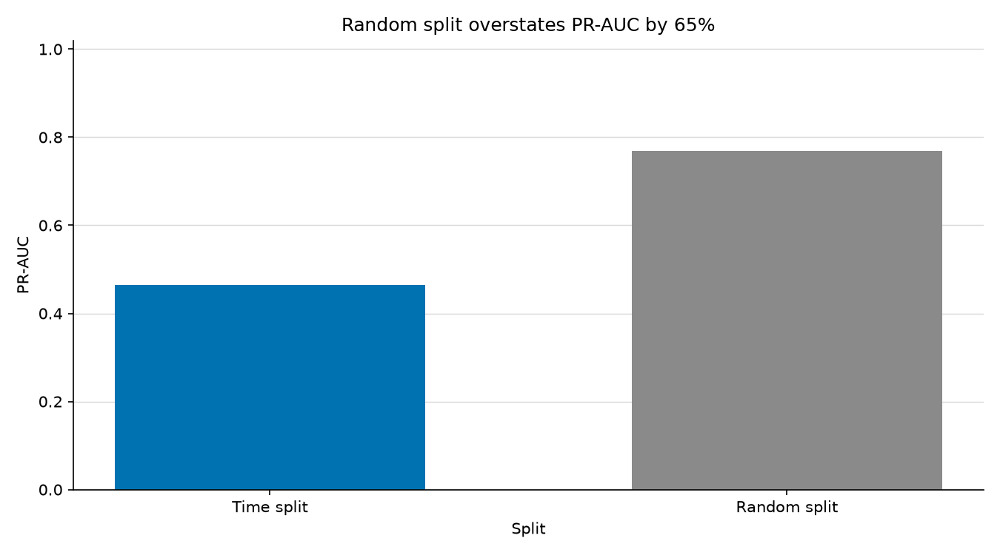

[English](README.md) | [Italiano](README.it.md)

# Fraud alert queue

I simulate fraud blocks and daily review staffing to compare net savings in USD.

**With P4 and five analysts, I get USD 8,801.49/day; the sixth adds USD 134.70/day.** I allow 60 alerts/analyst/day, so five analysts have a fixed 300-alert daily budget.



At that same five-analyst budget, I get **USD 8,135.26/day with P3 versus USD 1,966.44/day with block-only P1**, an increment of **USD 6,168.82/day**.
I inspect capacities and staffing after observing the same 45 test days. I treat these USD results as a descriptive simulation.






I keep Stage 3 Model C at **PR-AUC 0.5864**, **42.92% mean daily fraud amount caught (USD share)**, and **59.87% precision** at a 3% daily review share. For Stage 2, I get **PR-AUC 0.4654 time and 0.7691 random**, with **32.52% and 61.37% mean daily fraud amount caught (USD shares)** at the same share.

## Method

I block only from fraud labels available after 30 days and rank the remaining queue with fixed LightGBM scores. I assume USD 5.00/review, USD 15.00/false block, and USD 2.00/legitimate review in friction. I assume complete detection of reviewed fraud and prevention of its full USD value. Blocks consume no review capacity; review cost includes labour, so I add no separate analyst salary.
I inspect capacities from 0.5% to 40%, compare only newly added alerts for marginal value, and show separate P3/P4 staffing plans for 1-20 analysts.
I keep the 45-day test, 30-day gap, 15-day validation, seed 42, and validation-only early stopping. I fit categories on fitting rows only and perform no tuning. Stage 4 pools stopped-fraud USD shares and decision precision; Stage 3 uses equal-day means.

## Run

I use Python 3.12+ and place `train_transaction.csv` and `train_identity.csv` in `data/raw/`. I run Stage 4 after Stage 3 from saved scores and fit no models in Stage 4.

```sh
cd ~/Projects/fraud-alert-queue
python3.12 -m venv .venv
source .venv/bin/activate
python -m pip install -r requirements.txt
python -m src.run_baseline
python -m src.run_stage3
python -m src.run_stage4
python -m unittest discover -s tests -v
```

On macOS, I install `libomp` with Homebrew if LightGBM needs it. I save [Stage 2](reports/baseline_metrics.md), [Stage 3](reports/stage3_metrics.md), and [Stage 4](reports/stage4_policy.md) results locally.

## Data

I use data from the [Kaggle IEEE-CIS Fraud Detection competition](https://www.kaggle.com/competitions/ieee-fraud-detection/data); I do not include the data in this repo.
