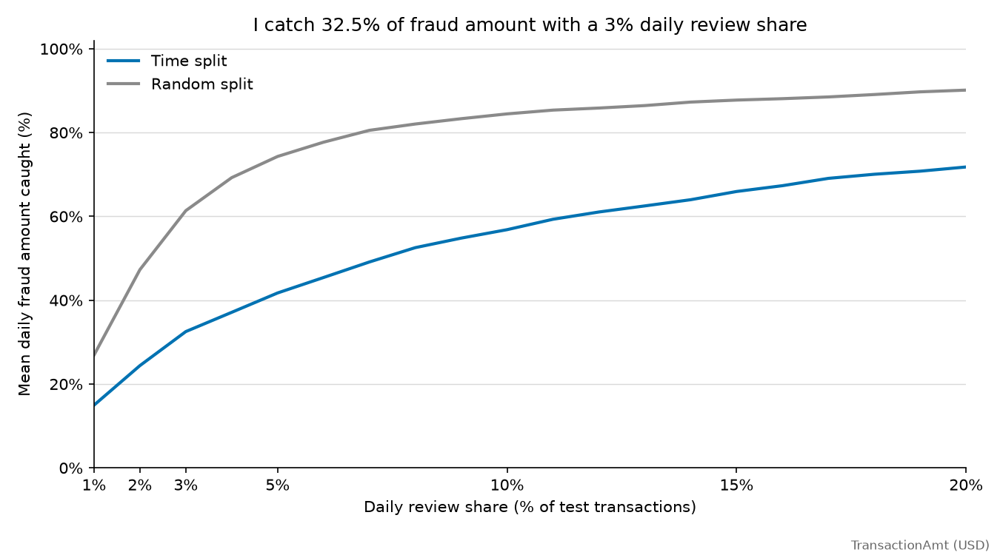
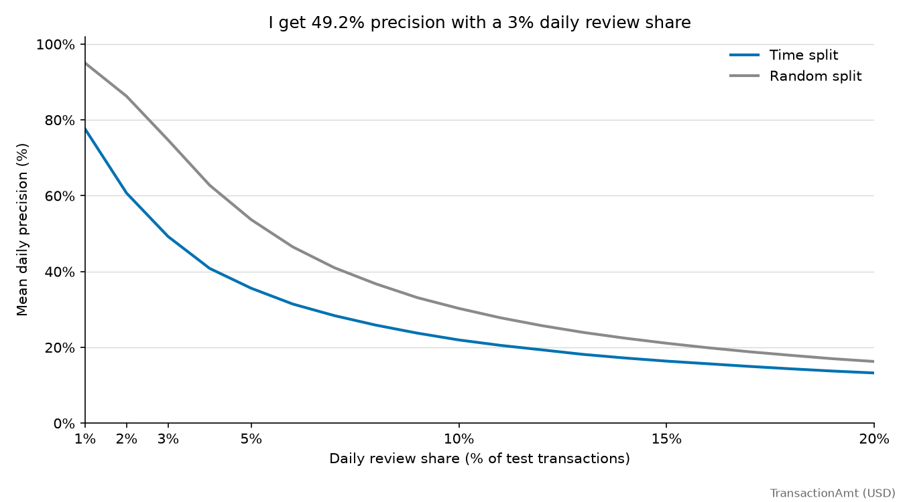
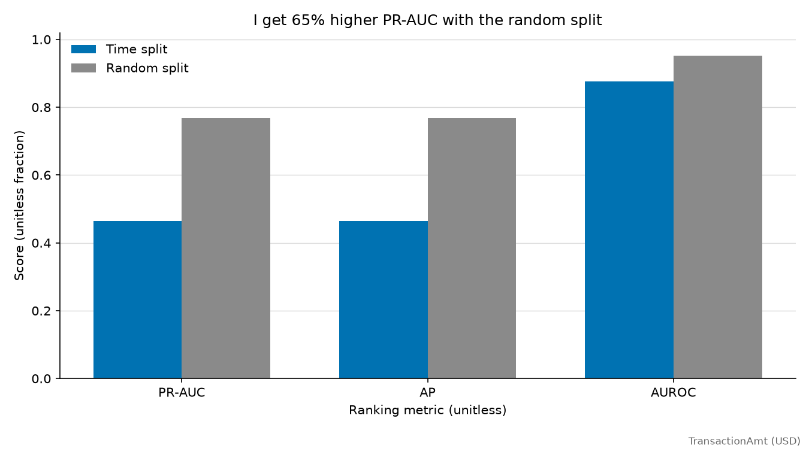

# Baseline results

I measure `TransactionAmt` in USD.

I compare two splits for a daily fraud review queue using 590,540 transactions.

| Metric | Time split | Random split |
| --- | ---: | ---: |
| PR-AUC (trapezoidal) | 0.4654 | 0.7691 |
| Average precision (AP) | 0.4654 | 0.7691 |
| ROC-AUC | 0.8754 | 0.9514 |
| Fraud amount caught @1% | 14.96% | 26.91% |
| Precision@1% | 77.59% | 94.99% |
| Fraud amount caught @2% | 24.40% | 47.28% |
| Precision@2% | 60.67% | 86.22% |
| Fraud amount caught @3% | 32.52% | 61.37% |
| Precision@3% | 49.22% | 74.68% |
| Fraud amount caught @5% | 41.73% | 74.30% |
| Precision@5% | 35.59% | 53.68% |

## Test coverage

I show row counts and inclusive relative day ranges. I calculate `day = TransactionDT // 86400`.

| Split | Fit rows (days) | Validation rows (days) | Dropped gap rows (days) | Test rows (days) | Best iteration |
| --- | ---: | ---: | ---: | ---: | ---: |
| Time | 326,186 (1-92) | 48,476 (93-107) | 89,100 (108-137) | 126,778 (138-182) | 482 |
| Random | 439,891 (1-167) | 32,541 (168-182) | 0 (-) | 118,108 (1-182) | 345 |

- I evaluate 45 time test days, including 45 with positive fraud amount. I average 2,817.3 test transactions/day.
- I evaluate 182 random test days, including 182 with positive fraud amount. I average 648.9 test transactions/day.

## Method

- I reserve the last 45 days for test, drop the previous 30 days for delayed chargeback labels, and use the previous 15 days for validation. I fit on earlier rows.
- I compare a seeded, target-stratified 80/20 random split. I use the last 15 days of its 80% development pool for validation and apply no delay gap.
- I use 432 raw features. I exclude `isFraud`, `TransactionID`, and `day`; I retain `TransactionDT`. I fit categories on fitting rows only and treat unknown categories as missing. I add no features and perform no tuning.
- I use LightGBM defaults, seed 42, and at most 1000 iterations. I stop after 50 rounds without improvement in validation AP. I never fit on test rows or use them for early stopping.
- I rank each test day by score, with ascending `TransactionID` for ties. I review `ceil(share * daily test rows)` transactions for each share. I use absolute K only on the time split.
- I divide captured fraud amount by all fraud amount that day, then average daily ratios equally. I exclude zero-fraud-amount days from this mean and keep `TransactionAmt` in float64.
- I divide selected frauds by selected transactions for precision, then average over all observed test days. I exclude days without test transactions.
- I calculate trapezoidal PR-AUC, AP, and ROC-AUC over the full test partition. I report AP separately from PR-AUC.

## Comparison

I get 65.3% higher PR-AUC with the random split. I train on later transactions than some random test rows, share days across partitions, and omit the label-delay gap.
I compare the same share of each daily test queue. I round the review count up to an integer.
I still compare different periods and training sizes, so I cannot attribute the difference solely to temporal leakage.

## Absolute capacity on the time split

| K (transactions/day) | Fraud amount caught | Precision |
| ---: | ---: | ---: |
| 50 | 23.09% | 64.04% |
| 100 | 35.64% | 44.38% |
| 200 | 50.61% | 28.30% |
| 500 | 69.74% | 14.48% |

I save daily share metrics and curve values in the adjacent CSVs. I keep absolute-capacity CSVs only for the time split.
I use data from the Kaggle IEEE-CIS Fraud Detection competition; I do not include the data in this repo.
I use these package versions: numpy 2.5.3, pandas 2.3.3, pyarrow 24.0.0, scikit-learn 1.9.1, lightgbm 4.7.0, matplotlib 3.11.2.
