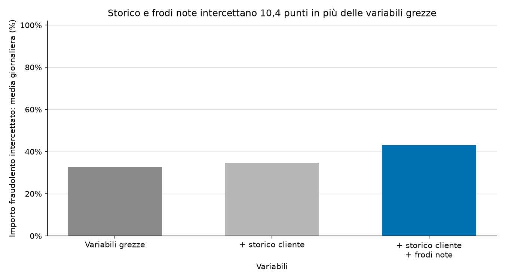
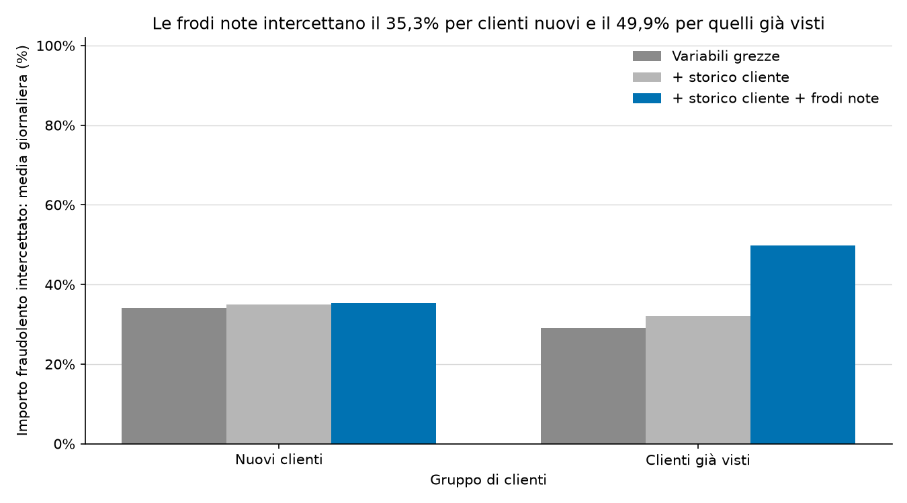

[English](stage3_metrics.md) | [Italiano](stage3_metrics.it.md)

# Risultati dello storico cliente

590.540 transazioni, con importi in USD. **+ storico cliente + frodi note** raggiunge **PR-AUC 0,5864 (+26,0% rispetto alle variabili grezze)** e intercetta il **42,92%** degli importi fraudolenti in media al giorno, controllando il 3% dei pagamenti.

| Modello | PR-AUC | ROC-AUC | Intercettato @1% | Precisione @1% | Intercettato @2% | Precisione @2% | Intercettato @3% | Precisione @3% | Intercettato @5% | Precisione @5% |
| --- | ---: | ---: | ---: | ---: | ---: | ---: | ---: | ---: | ---: | ---: |
| Variabili grezze | 0,4654 | 0,8754 | 14,96% | 77,59% | 24,40% | 60,67% | 32,52% | 49,22% | 41,73% | 35,59% |
| + storico cliente | 0,4678 | 0,8853 | 15,04% | 75,90% | 25,57% | 60,33% | 34,63% | 48,93% | 44,27% | 35,58% |
| + storico cliente + frodi note | 0,5864 | 0,9293 | 19,03% | 86,23% | 33,53% | 72,77% | 42,92% | 59,87% | 55,78% | 43,12% |

## Clienti nuovi e già osservati

Un cliente è nuovo quando nessuna transazione del suo UID ha un timestamp strettamente precedente; anche un UID mancante è considerato nuovo. Ogni segmento ha un budget giornaliero proprio, `ceil(quota * righe giornaliere del segmento)`. Si tratta di code indipendenti, senza dividere un budget comune. PR-AUC e ROC-AUC usano tutte le transazioni di test del segmento.

| Modello | Clienti | PR-AUC | ROC-AUC | Intercettato @1% | Precisione @1% | Intercettato @2% | Precisione @2% | Intercettato @3% | Precisione @3% | Intercettato @5% | Precisione @5% |
| --- | --- | ---: | ---: | ---: | ---: | ---: | ---: | ---: | ---: | ---: | ---: |
| Variabili grezze | Nuovi | 0,6328 | 0,9056 | 15,87% | 90,77% | 26,58% | 82,19% | 34,14% | 74,31% | 47,24% | 59,11% |
| Variabili grezze | Già osservati | 0,2102 | 0,8333 | 14,33% | 35,63% | 22,66% | 27,54% | 29,15% | 23,33% | 37,09% | 17,88% |
| + storico cliente | Nuovi | 0,6412 | 0,9159 | 16,46% | 89,30% | 26,37% | 81,81% | 35,03% | 75,43% | 47,47% | 59,52% |
| + storico cliente | Già osservati | 0,2037 | 0,8434 | 14,88% | 32,61% | 24,66% | 25,55% | 32,12% | 22,76% | 40,95% | 18,05% |
| + storico cliente + frodi note | Nuovi | 0,6431 | 0,9118 | 16,56% | 90,79% | 26,49% | 82,53% | 35,35% | 74,71% | 48,82% | 60,53% |
| + storico cliente + frodi note | Già osservati | 0,5148 | 0,9367 | 27,52% | 76,84% | 39,54% | 53,02% | 49,86% | 41,44% | 61,97% | 29,64% |

## Controlli sui clienti

I controlli usano tutte le transazioni disponibili. Gli UID mancanti sono esclusi dai conteggi dei clienti e dalla quota con entrambe le etichette, frode e pagamento legittimo.

| Controllo sui clienti | Valore |
| --- | ---: |
| UID distinti | 199.070 |
| Media delle transazioni per UID | 2,6310 |
| Mediana delle transazioni per UID | 1,0000 |
| UID con entrambe le etichette | 0,62% |
| Transazioni senza UID | 11,31% |

## Dati di test

Le tre combinazioni di variabili usano le stesse partizioni temporali. L'intervallo di attesa è escluso dall'addestramento e dall'arresto anticipato.

| Divisione | Righe di addestramento (giorni) | Righe di validazione (giorni) | Righe escluse (giorni) | Righe di test (giorni) | Iterazione scelta |
| --- | ---: | ---: | ---: | ---: | ---: |
| Temporale | 326.186 (1-92) | 48.476 (93-107) | 89.100 (108-137) | 126.778 (138-182) | 482 |
| Casuale | 439.891 (1-167) | 32.541 (168-182) | 0 (-) | 118.108 (1-182) | 345 |

## Metodo

- L'identificativo è `card1 + '_' + addr1 + '_' + (day - D1)`. I valori numerici interi sono uniformati prima di unire le stringhe. Se manca un componente, l'UID resta mancante e queste transazioni non vengono raggruppate fra loro.
- Le variabili grezze comprendono 432 input. Lo storico cliente aggiunge sei input: `uid_prev_count`, `uid_prev_mean_amt`, `amt_to_uid_mean`, `seconds_since_uid_prev_tx`, `days_since_uid_first_seen`, `uid_prev_distinct_P_emaildomain`. Le frodi note aggiungono `uid_known_fraud` allo storico. `uid`, `D1n`, `is_new_client`, `isFraud`, `TransactionID` e `day` sono esclusi dal modello.
- Gli aggregati usano soltanto timestamp strettamente precedenti. Le transazioni con lo stesso timestamp sono raggruppate prima del calcolo. Le transazioni precedenti non ancora etichettate dell'attesa e del test restano osservabili.
- Le frodi note usano soltanto etichette precedenti di almeno 30 giorni al timestamp corrente. Le etichette storiche del test entrano solo dopo l'attesa; il test non determina addestramento o arresto anticipato.
- Un UID mancante conserva uno storico mancante. Un UID valido nuovo ha zero transazioni, domini distinti e anzianità; importo e intervallo precedenti restano mancanti. Il rapporto fra importi è mancante quando la media precedente è zero.
- Scelgo una divisione temporale: 45 giorni di test, 30 di attesa e 15 di validazione immediatamente prima dell'attesa. Restano invariati parametri predefiniti di LightGBM, seme 42, massimo 1000 iterazioni e arresto basato solo sulla validazione dopo 50 iterazioni senza miglioramenti. Le categorie sono apprese soltanto dalle righe di addestramento.
- L'ordine giornaliero usa punteggi decrescenti e ID crescenti a parità di punteggio. Le quote sono 1%, 2%, 3% e 5%; i grafici mostrano 1%-20%.
- Importi e precisioni giornalieri hanno pesi uguali nella media. I giorni senza importi fraudolenti sono esclusi dai relativi rapporti. Le metriche di ordinamento usano l'intera partizione; un valore non definito è N/D.

## Capacità assoluta sulla divisione temporale

| K (transazioni/giorno) | Importo intercettato | Precisione |
| ---: | ---: | ---: |
| 50 | 23,09% | 64,04% |
| 100 | 35,64% | 44,38% |
| 200 | 50,61% | 28,30% |
| 500 | 69,74% | 14,48% |

Aggregati salvati: [variabili grezze](stage3_A_daily_metrics.csv), [storico cliente](stage3_B_daily_metrics.csv) e [frodi note](stage3_C_daily_metrics.csv). Il [rapporto del modello di base](baseline_metrics.it.md) contiene il confronto temporale e casuale.
I dati provengono da Kaggle IEEE-CIS Fraud Detection e non sono inclusi nel repository.
