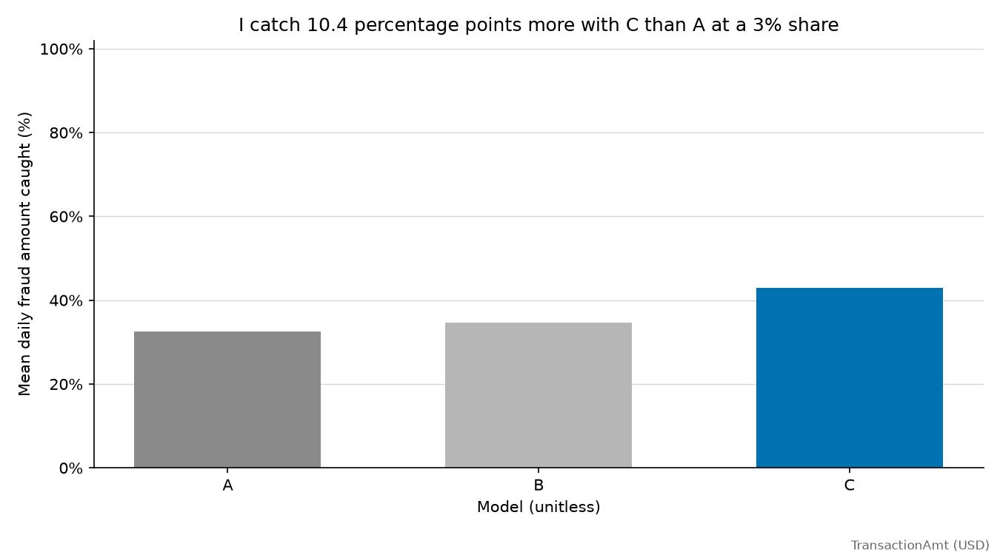
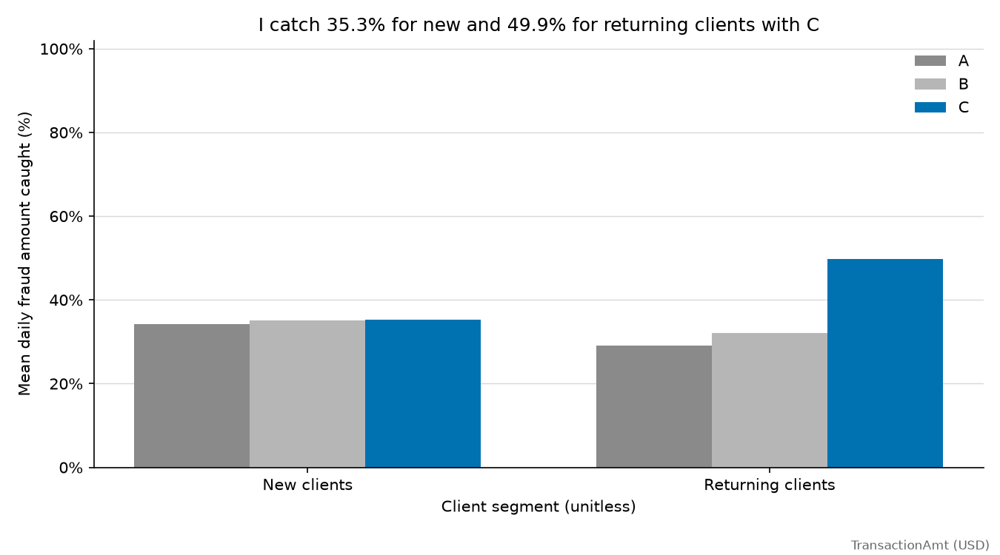

[English](stage3_metrics.md) | [Italiano](stage3_metrics.it.md)

# Client history results

I measure `TransactionAmt` in USD.

I compare three fixed models for a daily fraud review queue using 590,540 transactions.
I get **PR-AUC 0.5864 with Model C (+26.0% relative to A)** and catch **42.92%** of daily fraud amount when I review 3% of transactions.

| Model | PR-AUC | ROC-AUC | Caught @1% | Precision @1% | Caught @2% | Precision @2% | Caught @3% | Precision @3% | Caught @5% | Precision @5% |
| --- | ---: | ---: | ---: | ---: | ---: | ---: | ---: | ---: | ---: | ---: |
| Model A - Baseline | 0.4654 | 0.8754 | 14.96% | 77.59% | 24.40% | 60.67% | 32.52% | 49.22% | 41.73% | 35.59% |
| Model B - Client history | 0.4678 | 0.8853 | 15.04% | 75.90% | 25.57% | 60.33% | 34.63% | 48.93% | 44.27% | 35.58% |
| Model C - Client history + delayed labels | 0.5864 | 0.9293 | 19.03% | 86.23% | 33.53% | 72.77% | 42.92% | 59.87% | 55.78% | 43.12% |

## New and returning clients

I call a client new when I have no strictly earlier transaction for its UID. I also treat missing UIDs as new.
I assign each segment its own daily review budget. I calculate `ceil(share * daily segment rows)`, so these are separate queues rather than a partition of one shared budget.
I calculate PR-AUC and ROC-AUC across all test rows within each segment.

| Model | Clients | PR-AUC | ROC-AUC | Caught @1% | Precision @1% | Caught @2% | Precision @2% | Caught @3% | Precision @3% | Caught @5% | Precision @5% |
| --- | --- | ---: | ---: | ---: | ---: | ---: | ---: | ---: | ---: | ---: | ---: |
| Model A - Baseline | New | 0.6328 | 0.9056 | 15.87% | 90.77% | 26.58% | 82.19% | 34.14% | 74.31% | 47.24% | 59.11% |
| Model A - Baseline | Returning | 0.2102 | 0.8333 | 14.33% | 35.63% | 22.66% | 27.54% | 29.15% | 23.33% | 37.09% | 17.88% |
| Model B - Client history | New | 0.6412 | 0.9159 | 16.46% | 89.30% | 26.37% | 81.81% | 35.03% | 75.43% | 47.47% | 59.52% |
| Model B - Client history | Returning | 0.2037 | 0.8434 | 14.88% | 32.61% | 24.66% | 25.55% | 32.12% | 22.76% | 40.95% | 18.05% |
| Model C - Client history + delayed labels | New | 0.6431 | 0.9118 | 16.56% | 90.79% | 26.49% | 82.53% | 35.35% | 74.71% | 48.82% | 60.53% |
| Model C - Client history + delayed labels | Returning | 0.5148 | 0.9367 | 27.52% | 76.84% | 39.54% | 53.02% | 49.86% | 41.44% | 61.97% | 29.64% |

## Client checks

I calculate these checks over all available raw transactions. I omit missing UIDs from client counts and from the share of UIDs with both labels.

| Client check | Value |
| --- | ---: |
| UIDs | 199,070 |
| Mean transactions per UID | 2.6310 |
| Median transactions per UID | 1.0000 |
| UIDs with both labels | 0.62% |
| Transactions with missing UID | 11.31% |

## Test coverage

I keep the baseline's time and random partitions below. I use the same time partitions for Models A, B, and C; I keep the dropped gap out of fitting and early stopping.

| Split | Fit rows (days) | Validation rows (days) | Dropped gap rows (days) | Test rows (days) | Best iteration |
| --- | ---: | ---: | ---: | ---: | ---: |
| Time | 326,186 (1-92) | 48,476 (93-107) | 89,100 (108-137) | 126,778 (138-182) | 482 |
| Random | 439,891 (1-167) | 32,541 (168-182) | 0 (-) | 118,108 (1-182) | 345 |

## Method

- I form `D1n = day - D1` and `uid = card1 + '_' + addr1 + '_' + D1n`. I normalize whole numeric values before joining the strings. If `card1`, `addr1`, or `D1` is missing, I leave the UID missing and never group those rows together.
- I fit Model A on 432 raw features. I add six client-history features for B: `uid_prev_count`, `uid_prev_mean_amt`, `amt_to_uid_mean`, `seconds_since_uid_prev_tx`, `days_since_uid_first_seen`, `uid_prev_distinct_P_emaildomain`. I add only `uid_known_fraud` to B for Model C. I exclude `uid`, `D1n`, and `is_new_client` from every model, along with `isFraud`, `TransactionID`, and `day`.
- I use only transactions with strictly smaller `TransactionDT` for counts, mean amount, time intervals, and distinct nonmissing email domains. I group timestamp ties before calculating history. I include earlier unlabeled transactions from the gap and test period because those transactions are available online.
- I set `uid_known_fraud = 1` only when I have a fraud for the UID with `TransactionDT <= current TransactionDT - 30 * 86400`. I use the exact timestamp cutoff. Historical test labels may enter this feature after the delay; I never fit models or stop training on test rows.
- I keep all six history features missing for a missing UID. For a known UID with no history, I use count 0, distinct emails 0, and days since first seen 0; previous mean and previous interval stay missing. I keep the amount ratio missing when the previous mean is zero.
- I reserve the last 45 days for test, drop the preceding 30 days, and use the preceding 15 days for validation. I keep LightGBM defaults, seed 42, at most 1000 iterations, and early stopping after 50 rounds without improvement in validation AP. I fit categorical levels on fitting rows only and perform no tuning.
- I rank each observed day by score, with ascending `TransactionID` for ties. I review `ceil(share * daily test rows)` transactions at shares of 1%, 2%, 3%, and 5%. I plot shares from 1% to 20%.
- I average daily fraud-amount ratios equally and exclude days with zero fraud amount. I average precision across observed days and omit days without transactions in the queue. I calculate trapezoidal PR-AUC and ROC-AUC over the full evaluated partition; I use N/A when a metric is undefined.

## Absolute capacity on the time split

| K (transactions/day) | Fraud amount caught | Precision |
| ---: | ---: | ---: |
| 50 | 23.09% | 64.04% |
| 100 | 35.64% | 44.38% |
| 200 | 50.61% | 28.30% |
| 500 | 69.74% | 14.48% |

I keep the Stage 2 comparison in [baseline results](baseline_metrics.md), write the feature table to `data/processed/train_stage3.parquet`, and save test scores and daily metric CSVs locally.
I use data from the Kaggle IEEE-CIS Fraud Detection competition; I do not include the data in this repo.
