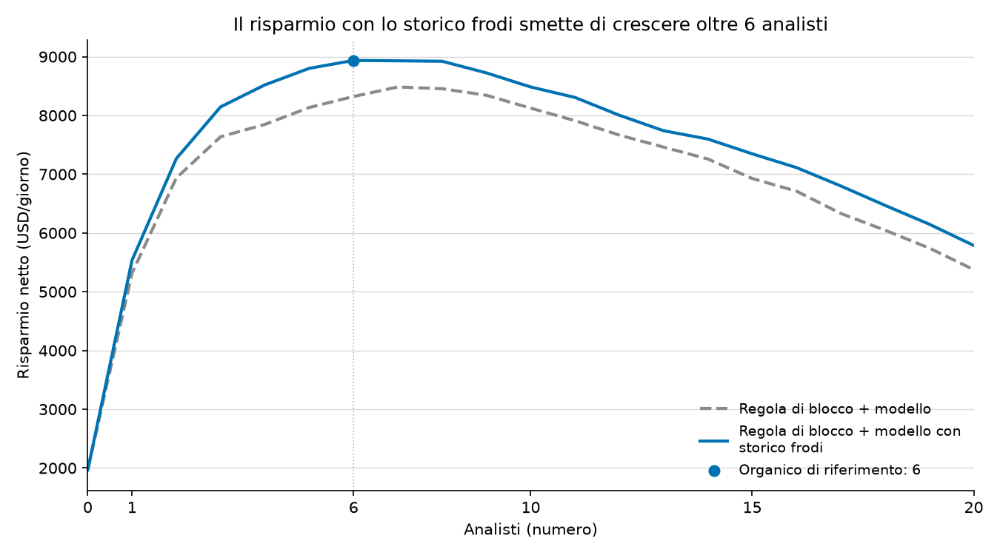
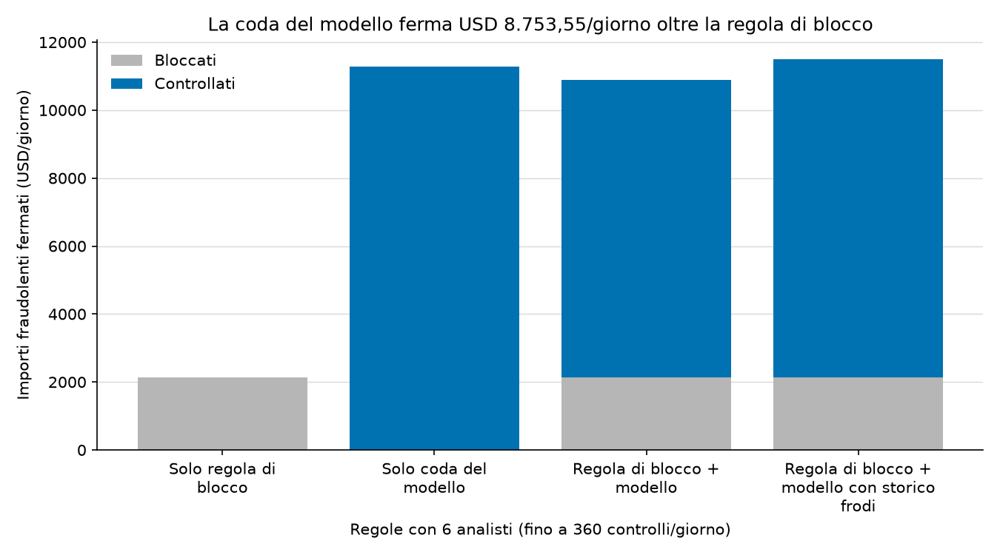
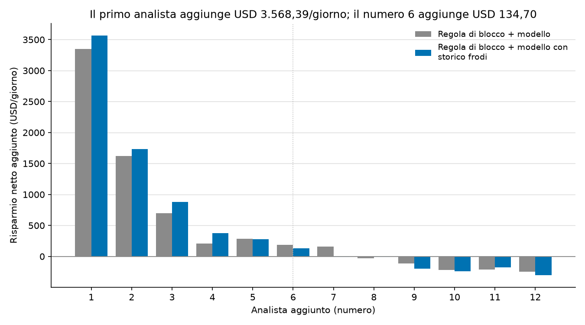
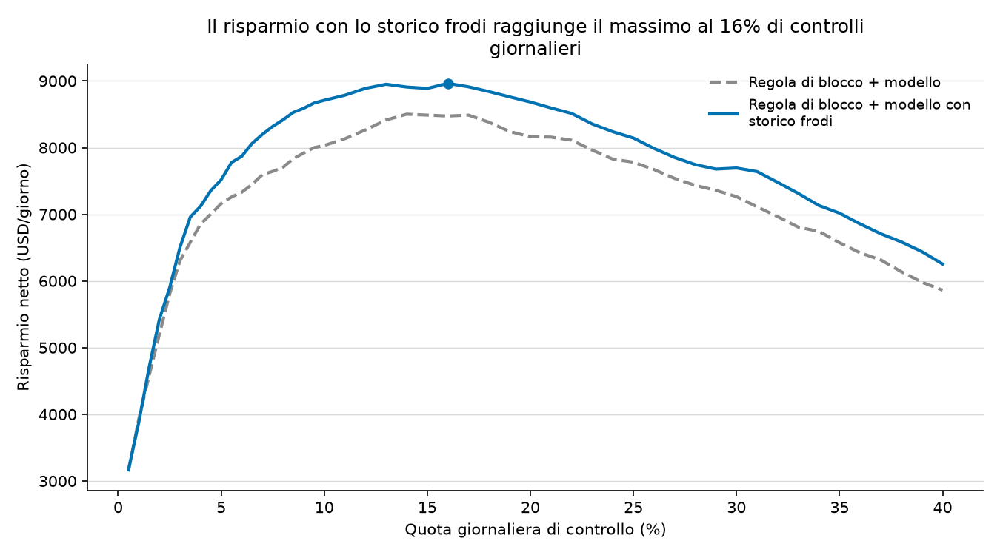

[English](stage4_policy.md) | [Italiano](stage4_policy.it.md)

# Regole decisionali e costi

45 giorni di test, con importi e costi in USD. L'organico di riferimento comprende **6 analisti**, il massimo salvato per **Regola di blocco + modello con storico frodi**: **USD 8.936,19/giorno**.
Con lo stesso organico, **Regola di blocco + modello** aggiunge **USD 6.356,08/giorno** rispetto a **Solo regola di blocco**.

## Regole con l'organico di riferimento

Ogni analista può controllare 60 operazioni/giorno. Il budget di riferimento è di 360 controlli/giorno; i blocchi non consumano quota di controllo.

| Regola | Quota di pagamenti controllati | Importi fraudolenti fermati (USD/giorno) | Importi fraudolenti fermati (USD/periodo) | Quota degli importi fermati | Precisione dei blocchi | Precisione dei controlli | Blocchi errati/giorno | Attrito dei controlli legittimi USD/giorno | Risparmio netto USD/giorno |
| --- | ---: | ---: | ---: | ---: | ---: | ---: | ---: | ---: | ---: |
| Solo regola di blocco | 0,00% | 2.126,77 | 95.704,64 | 14,46% | 58,21% | N/D | 10,69 | 0,00 | 1.966,44 |
| Solo coda del modello | 12,78% | 11.270,59 | 507.176,66 | 76,62% | N/D | 21,31% | 0,00 | 566,58 | 8.904,01 |
| Regola di blocco + modello | 12,78% | 10.880,32 | 489.614,41 | 73,96% | 58,21% | 17,02% | 10,69 | 597,47 | 8.322,52 |
| Regola di blocco + modello con storico frodi | 12,78% | 11.490,48 | 517.071,48 | 78,11% | 58,21% | 17,51% | 10,69 | 593,96 | 8.936,19 |

## Confronto delle quote giornaliere

Il confronto originale usa una quota giornaliera del 3,00%. Questi risultati salvati non cambiano.

| Regola | Quota di controllo | Importi fraudolenti fermati (USD/giorno) | Importi fraudolenti fermati (USD/periodo) | Quota degli importi fermati | Precisione dei blocchi | Precisione dei controlli | Blocchi errati/giorno | Attrito dei controlli legittimi USD/giorno | Risparmio netto USD/giorno |
| --- | ---: | ---: | ---: | ---: | ---: | ---: | ---: | ---: | ---: |
| Solo regola di blocco | 0,00% | 2.126,77 | 95.704,64 | 14,46% | 58,21% | N/D | 10,69 | 0,00 | 1.966,44 |
| Solo coda del modello | 3,00% | 6.196,27 | 278.832,04 | 42,12% | N/D | 59,96% | 0,00 | 68,04 | 5.703,33 |
| Regola di blocco + modello | 3,00% | 6.979,39 | 314.072,56 | 47,44% | 58,21% | 46,97% | 10,69 | 90,13 | 6.304,03 |
| Regola di blocco + modello con storico frodi | 3,00% | 7.177,25 | 322.976,17 | 48,79% | 58,21% | 48,30% | 10,69 | 87,87 | 6.504,16 |

## Quote e organico

| Regola | Migliore quota esaminata | Risparmio netto USD/giorno | Controlli medi/giorno | Media degli analisti giornalieri | Massimo degli analisti giornalieri | FTE dei controlli |
| --- | ---: | ---: | ---: | ---: | ---: | ---: |
| Regola di blocco + modello | 14,00% | 8.501,40 | 394,91 | 7,11 | 10 | 6,58 |
| Regola di blocco + modello con storico frodi | 16,00% | 8.963,40 | 451,27 | 8,04 | 11 | 7,52 |

Il massimo sulla griglia percentuale è **Solo coda del modello** al 16,00%: USD 8.984,00/giorno. Un organico fisso e una coda percentuale assegnano budget giornalieri diversi.
Ogni incremento di organico corrisponde a 60 controlli disponibili in più al giorno. Il grafico marginale mostra gli analisti 1-12, senza trattare incrementi percentuali diversi come equivalenti.

| Regola | Analisti | Budget controlli/giorno | Controlli effettivi medi/giorno | Quota media del volume giornaliero | Risparmio netto USD/giorno | Incremento USD/giorno rispetto a un analista in meno |
| --- | ---: | ---: | ---: | ---: | ---: | ---: |
| Regola di blocco + modello | 1 | 60 | 60,00 | 2,17% | 5.316,99 | 3.350,55 |
| Regola di blocco + modello | 2 | 120 | 120,00 | 4,34% | 6.936,15 | 1.619,16 |
| Regola di blocco + modello | 3 | 180 | 180,00 | 6,51% | 7.637,51 | 701,36 |
| Regola di blocco + modello | 4 | 240 | 240,00 | 8,68% | 7.847,62 | 210,11 |
| Regola di blocco + modello | 5 | 300 | 300,00 | 10,85% | 8.135,26 | 287,64 |
| Regola di blocco + modello | 6 | 360 | 360,00 | 13,02% | 8.322,52 | 187,26 |
| Regola di blocco + modello | 7 | 420 | 420,00 | 15,19% | 8.484,37 | 161,85 |
| Regola di blocco + modello | 8 | 480 | 480,00 | 17,36% | 8.454,76 | -29,61 |
| Regola di blocco + modello | 9 | 540 | 540,00 | 19,53% | 8.343,12 | -111,64 |
| Regola di blocco + modello | 10 | 600 | 600,00 | 21,70% | 8.124,36 | -218,76 |
| Regola di blocco + modello | 11 | 660 | 660,00 | 23,87% | 7.910,58 | -213,78 |
| Regola di blocco + modello | 12 | 720 | 720,00 | 26,04% | 7.665,70 | -244,88 |
| Regola di blocco + modello | 13 | 780 | 780,00 | 28,21% | 7.460,78 | -204,92 |
| Regola di blocco + modello | 14 | 840 | 840,00 | 30,38% | 7.259,01 | -201,78 |
| Regola di blocco + modello | 15 | 900 | 900,00 | 32,55% | 6.926,80 | -332,21 |
| Regola di blocco + modello | 16 | 960 | 960,00 | 34,73% | 6.710,91 | -215,89 |
| Regola di blocco + modello | 17 | 1.020 | 1.020,00 | 36,90% | 6.332,13 | -378,78 |
| Regola di blocco + modello | 18 | 1.080 | 1.080,00 | 39,07% | 6.046,07 | -286,06 |
| Regola di blocco + modello | 19 | 1.140 | 1.140,00 | 41,24% | 5.741,51 | -304,56 |
| Regola di blocco + modello | 20 | 1.200 | 1.200,00 | 43,41% | 5.376,26 | -365,25 |

| Regola | Analisti | Budget controlli/giorno | Controlli effettivi medi/giorno | Quota media del volume giornaliero | Risparmio netto USD/giorno | Incremento USD/giorno rispetto a un analista in meno |
| --- | ---: | ---: | ---: | ---: | ---: | ---: |
| Regola di blocco + modello con storico frodi | 1 | 60 | 60,00 | 2,17% | 5.534,83 | 3.568,39 |
| Regola di blocco + modello con storico frodi | 2 | 120 | 120,00 | 4,34% | 7.265,80 | 1.730,97 |
| Regola di blocco + modello con storico frodi | 3 | 180 | 180,00 | 6,51% | 8.146,36 | 880,56 |
| Regola di blocco + modello con storico frodi | 4 | 240 | 240,00 | 8,68% | 8.520,30 | 373,95 |
| Regola di blocco + modello con storico frodi | 5 | 300 | 300,00 | 10,85% | 8.801,49 | 281,19 |
| Regola di blocco + modello con storico frodi | 6 | 360 | 360,00 | 13,02% | 8.936,19 | 134,70 |
| Regola di blocco + modello con storico frodi | 7 | 420 | 420,00 | 15,19% | 8.930,02 | -6,16 |
| Regola di blocco + modello con storico frodi | 8 | 480 | 480,00 | 17,36% | 8.922,45 | -7,57 |
| Regola di blocco + modello con storico frodi | 9 | 540 | 540,00 | 19,53% | 8.723,99 | -198,47 |
| Regola di blocco + modello con storico frodi | 10 | 600 | 600,00 | 21,70% | 8.484,35 | -239,64 |
| Regola di blocco + modello con storico frodi | 11 | 660 | 660,00 | 23,87% | 8.306,33 | -178,02 |
| Regola di blocco + modello con storico frodi | 12 | 720 | 720,00 | 26,04% | 8.003,43 | -302,90 |
| Regola di blocco + modello con storico frodi | 13 | 780 | 780,00 | 28,21% | 7.739,82 | -263,61 |
| Regola di blocco + modello con storico frodi | 14 | 840 | 840,00 | 30,38% | 7.597,91 | -141,91 |
| Regola di blocco + modello con storico frodi | 15 | 900 | 900,00 | 32,55% | 7.347,00 | -250,91 |
| Regola di blocco + modello con storico frodi | 16 | 960 | 960,00 | 34,73% | 7.112,38 | -234,62 |
| Regola di blocco + modello con storico frodi | 17 | 1.020 | 1.020,00 | 36,90% | 6.799,70 | -312,68 |
| Regola di blocco + modello con storico frodi | 18 | 1.080 | 1.080,00 | 39,07% | 6.469,18 | -330,51 |
| Regola di blocco + modello con storico frodi | 19 | 1.140 | 1.140,00 | 41,24% | 6.148,00 | -321,18 |
| Regola di blocco + modello con storico frodi | 20 | 1.200 | 1.200,00 | 43,41% | 5.787,95 | -360,05 |

## Ultimo incremento percentuale

| Regola | Ultimo incremento della quota | Nuovi controlli/giorno | Precisione dei nuovi controlli | USD medi/frode aggiunta | USD lordi/nuovo controllo | Costo USD/nuovo controllo | USD netti aggiunti/giorno |
| --- | ---: | ---: | ---: | ---: | ---: | ---: | ---: |
| Regola di blocco + modello | 39,00% fino a 40,00% | 28,07 | 1,27% | 218,23 | 2,76 | 6,97 | -118,16 |
| Regola di blocco + modello con storico frodi | 39,00% fino a 40,00% | 28,07 | 0,48% | 83,40 | 0,40 | 6,99 | -185,08 |

Il valore lordo per controllo aggiunto è la precisione dei nuovi controlli moltiplicata per l'importo medio in USD delle frodi aggiunte. Il costo è quello del controllo più l'attrito moltiplicato per la quota legittima. Il netto dell'ultimo incremento è la differenza fra il risparmio totale delle due quote adiacenti.

## Sensibilità

Assumo USD 5,00 per controllo, USD 15,00 per blocco errato e USD 2,00 di attrito per ogni controllo legittimo. La griglia salvata varia queste ipotesi e seleziona la regola e la quota migliori nell'intervallo esaminato.

| Costo USD/controllo | Costo USD/blocco errato | Attrito USD/controllo legittimo | Migliore regola | Migliore quota esaminata | Risparmio netto USD/giorno |
| --- | ---: | ---: | ---: | ---: | ---: |
| 2,00 | 5,00 | 0,00 | Solo coda del modello | 32,00% | 11.968,84 |
| 2,00 | 5,00 | 2,00 | Regola di blocco + modello con storico frodi | 20,00% | 10.482,37 |
| 2,00 | 5,00 | 5,00 | Regola di blocco + modello con storico frodi | 16,00% | 9.268,89 |
| 2,00 | 15,00 | 0,00 | Solo coda del modello | 32,00% | 11.968,84 |
| 2,00 | 15,00 | 2,00 | Solo coda del modello | 20,00% | 10.457,38 |
| 2,00 | 15,00 | 5,00 | Solo coda del modello | 16,00% | 9.224,93 |
| 2,00 | 50,00 | 0,00 | Solo coda del modello | 32,00% | 11.968,84 |
| 2,00 | 50,00 | 2,00 | Solo coda del modello | 20,00% | 10.457,38 |
| 2,00 | 50,00 | 5,00 | Solo coda del modello | 16,00% | 9.224,93 |
| 5,00 | 5,00 | 0,00 | Regola di blocco + modello con storico frodi | 17,00% | 9.843,91 |
| 5,00 | 5,00 | 2,00 | Regola di blocco + modello con storico frodi | 16,00% | 9.070,29 |
| 5,00 | 5,00 | 5,00 | Regola di blocco + modello con storico frodi | 12,00% | 8.166,26 |
| 5,00 | 15,00 | 0,00 | Solo coda del modello | 18,00% | 9.777,03 |
| 5,00 | 15,00 | 2,00 | Solo coda del modello | 16,00% | 8.984,00 |
| 5,00 | 15,00 | 5,00 | Solo coda del modello | 12,00% | 8.075,00 |
| 5,00 | 50,00 | 0,00 | Solo coda del modello | 18,00% | 9.777,03 |
| 5,00 | 50,00 | 2,00 | Solo coda del modello | 16,00% | 8.984,00 |
| 5,00 | 50,00 | 5,00 | Solo coda del modello | 12,00% | 8.075,00 |
| 10,00 | 5,00 | 0,00 | Regola di blocco + modello con storico frodi | 12,00% | 7.855,70 |
| 10,00 | 5,00 | 2,00 | Regola di blocco + modello con storico frodi | 8,50% | 7.435,82 |
| 10,00 | 5,00 | 5,00 | Regola di blocco + modello con storico frodi | 7,50% | 6.895,18 |
| 10,00 | 15,00 | 0,00 | Regola di blocco + modello con storico frodi | 12,00% | 7.748,81 |
| 10,00 | 15,00 | 2,00 | Regola di blocco + modello con storico frodi | 8,50% | 7.328,93 |
| 10,00 | 15,00 | 5,00 | Regola di blocco + modello con storico frodi | 7,50% | 6.788,29 |
| 10,00 | 50,00 | 0,00 | Solo coda del modello | 12,00% | 7.695,67 |
| 10,00 | 50,00 | 2,00 | Solo coda del modello | 9,50% | 7.278,43 |
| 10,00 | 50,00 | 5,00 | Solo coda del modello | 8,00% | 6.713,62 |

## Metodo e limiti

- Il blocco automatico usa soltanto frodi confermate almeno 30 giorni prima. Le transazioni restanti sono ordinate dai punteggi salvati del modello con storico cliente, con o senza storico delle frodi note. A parità di punteggio prevale l'ID transazione più basso.
- Il risparmio netto è l'importo fraudolento fermato in USD meno tutti i costi di controllo, dei blocchi errati e dell'attrito sui controlli legittimi. Il costo per controllo include il lavoro, senza aggiungere stipendi separati.
- Ogni frode controllata si considera individuata e il suo intero importo impedito. L'esito serve alla valutazione e non determina la coda corrente.
- Quote degli importi e precisioni sono calcolate sommando numeratori e denominatori dell'intero periodo. Risparmio e controlli giornalieri sono medie sui giorni osservati.
- Organico e massimi percentuali sono scelti sugli stessi giorni di test usati per misurare il risparmio. La simulazione descrive questi dati e non garantisce risultati futuri.

Aggregati salvati: [regole](stage4_policy_metrics.csv), [organico](stage4_analyst_metrics.csv), [quote](stage4_capacity_curve.csv), [dettaglio degli incrementi percentuali](stage4_marginal_value.csv) e [sensibilità](stage4_sensitivity.csv).
I dati provengono dalla competizione Kaggle IEEE-CIS Fraud Detection e non sono inclusi nel repository.
