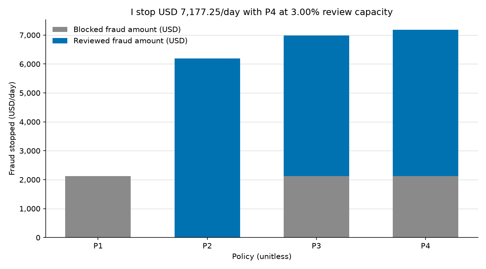
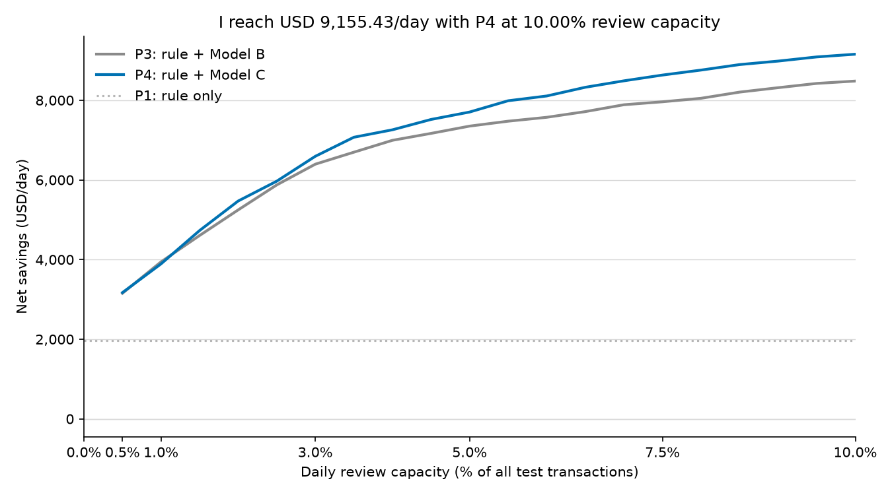

[English](stage4_policy.md) | [Italiano](stage4_policy.it.md)

# Policy simulation in USD

I simulate four decision policies on the same 45 observed time-test days.
I get the highest net savings across all four policies within the tested 0.5%-10% review-capacity range with **P4 at 10.00% daily review capacity: USD 9,155.43/day**.
I choose this capacity after examining these test days; I treat the result as a descriptive simulation, not a claim about future performance.
At 10.00%, I reach the scan's upper endpoint; I have not tested higher capacities.

## Default review capacity

I give P2, P3, and P4 a 3.00% budget based on each day's full transaction volume. P1 makes no reviews and has zero review capacity.

| Policy | Review capacity share | Fraud amount stopped (USD/day) | Fraud amount stopped (USD/period) | Fraud amount stopped share | Block precision | Review precision | False blocks/day | Net savings USD/day |
| --- | ---: | ---: | ---: | ---: | ---: | ---: | ---: | ---: |
| P1 | 0.00% | 2,126.77 | 95,704.64 | 14.46% | 58.21% | N/A | 10.69 | 1,966.44 |
| P2 | 3.00% | 6,196.27 | 278,832.04 | 42.12% | N/A | 59.96% | 0.00 | 5,771.38 |
| P3 | 3.00% | 6,979.39 | 314,072.56 | 47.44% | 58.21% | 46.97% | 10.69 | 6,394.17 |
| P4 | 3.00% | 7,177.25 | 322,976.17 | 48.79% | 58.21% | 48.30% | 10.69 | 6,592.03 |

## Capacity scan

I scan P2, P3, and P4 from 0.5% to 10% in 0.5 percentage-point steps and include P1 at zero. I break equal net-savings ties by lower capacity, then lower policy number.
I find these capacities for P3 and P4 on the same test period:

| Policy | Best scanned review capacity share | Fraud amount stopped (USD/day) | Review cost USD/day | False-block cost USD/day | Net savings USD/day | Net savings USD/period |
| --- | ---: | ---: | ---: | ---: | ---: | ---: |
| P3 | 10.00% | 10,051.80 | 1,410.44 | 160.33 | 8,481.02 | 381,645.91 |
| P4 | 10.00% | 10,726.21 | 1,410.44 | 160.33 | 9,155.43 | 411,994.37 |

At P3's best scanned capacity of **10.00%**, I get **USD 8,481.02/day with P3 versus USD 1,966.44/day with P1**, an increment of **USD 6,514.58/day**.

## Cost sensitivity

I rescore the same decisions for nine review-cost and false-block-cost pairs. These are cost scenarios, not uncertainty intervals. For each pair, I select the highest net savings across all policies and scanned capacities.

| Review cost USD/review | False-block cost USD/false block | Best policy | Best scanned review capacity share | Net savings USD/day |
| ---: | ---: | --- | ---: | ---: |
| 2.00 | 5.00 | P4 | 10.00% | 10,108.59 |
| 2.00 | 15.00 | P4 | 10.00% | 10,001.70 |
| 2.00 | 50.00 | P2 | 10.00% | 9,916.19 |
| 5.00 | 5.00 | P4 | 10.00% | 9,262.32 |
| 5.00 | 15.00 | P4 | 10.00% | 9,155.43 |
| 5.00 | 50.00 | P2 | 10.00% | 9,069.92 |
| 10.00 | 5.00 | P4 | 9.50% | 7,853.27 |
| 10.00 | 15.00 | P4 | 9.50% | 7,746.38 |
| 10.00 | 50.00 | P2 | 9.50% | 7,670.74 |

## Decision rules and assumptions

- I use P1 to block `uid_known_fraud == 1` and approve every other transaction.
- I use P2 to review by Model C without automatic blocks.
- I use P3 to block known-fraud UIDs first, then review the remainder by Model B.
- I use P4 to block known-fraud UIDs first, then review the remainder by Model C.
- I use only the delayed `uid_known_fraud` feature for the rule. It becomes available 30 days after a past fraud. I never use the current row's fraud label to choose a decision; I use labels afterward to account for fraud amounts in USD and false blocks.
- I assume every review costs **USD 5.00** and every legitimate transaction blocked costs **USD 15.00**. I assume reviews catch **100%** of selected frauds and prevent **100%** of each stopped fraudulent transaction's USD value. I assign no review cost to automatic blocks and no cost to an approval.
- I let blocks consume no review capacity. I calculate `ceil(capacity_share * all daily test rows)` reviews, capped at the number of rows left after blocking. I rank the remainder by score and use ascending `TransactionID` for ties.
- I calculate net savings in USD as stopped fraud amount minus review costs minus false-block costs. I average daily USD equally; period USD is the sum over all observed days.
- I pool the fraud amount stopped share over the entire period: stopped fraud amount divided by all fraud amount, both in USD. I also pool block and review precision over their decisions. I show N/A when a denominator is zero. These differ from Stage 3's equal-day means of daily fraud-amount ratios and daily precision.

I keep the full [capacity scan](stage4_capacity_curve.csv) and [cost sensitivity](stage4_sensitivity.csv) next to this report. I run Stage 4 after Stage 3 using saved test scores; I fit no models in Stage 4.
I use data from the Kaggle IEEE-CIS Fraud Detection competition; I do not include the data in this repo.
